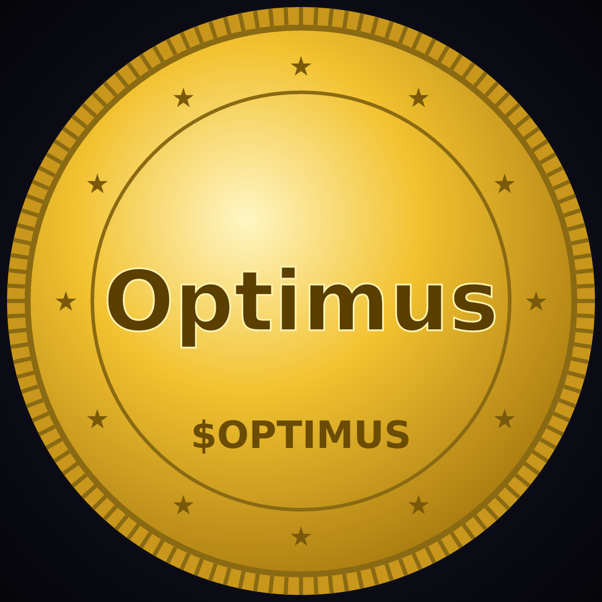

<div dir="rtl">

# בוט מטבעות של איילון

הבוט יושב על החשבון של איילון מאסק ב X. כל פוסט חדש עובר ל Claude, שבוחר את המילים ששוות מטבע: שמות מוצרים, רובוטים, כינויים, שמות גנאי ומילות חיבה. כל מילה כזאת הופכת למטבע על סולנה דרך pump.fun, עם תמונה של מטבע זהב שהמילה חקוקה בו.



## איך זה עובד

1. `src/x.ts` שואל את X API כל דקה אם יש פוסט חדש (בלי תגובות ובלי ריפוסטים).
2. `src/analyze.ts` שולח את הפוסט ל Claude ומקבל רשימת מילים עם ציון חשיבות.
3. `src/image.ts` מצייר את המטבע.
4. `src/launch.ts` מעלה תמונה ומטא דאטה ל IPFS של pump.fun, מקבל טרנזקציה מ PumpPortal, חותם עליה מקומית ושולח.
5. `state.json` זוכר מה כבר הושק, כדי שאותה מילה לא תהפוך למטבע פעמיים.

## הפעלה

```bash
npm install
cp .env.example .env   # למלא מפתחות
npm run test-post -- "Optimus will dance at the Grok party"   # ניסיון בלי X ובלי כסף
npm start
```

`DRY_RUN=true` כברירת מחדל: הבוט עושה הכל חוץ מלשלוח כסף לרשת. רק כשאתה מרוצה, `DRY_RUN=false` ומפתח ארנק.

## מה צריך

* מפתח Anthropic.
* X API. החינמי לא מספיק לקריאת טיימליין, צריך מסלול בתשלום.
* ארנק סולנה נפרד, רק לבוט, עם מעט SOL. כל השקה עולה בערך 0.02 SOL עמלות פלוס הקנייה הראשונה שלך (`DEV_BUY_SOL`).
* RPC טוב (Helius, QuickNode). הציבורי איטי.

## בלמים

* `MIN_IMPORTANCE`: מתחת לציון הזה לא משיקים.
* `MAX_COINS_PER_POST`: תקרה לפוסט.
* `MAX_SOL_PER_DAY`: תקרת הוצאה יומית.
* בהרצה הראשונה הבוט לא משיק על פוסטים ישנים, רק מסמן מאיפה להתחיל.

## הבוט לא מגיב לאיילון

הוא קורא את הפוסטים ומגיב בהשקה. הוא לא כותב תגובות מתחת לפוסטים של איילון: X חוסם בוטים שעושים את זה, והחשבון יעוף תוך יום. אם `ANNOUNCE_ON_X=true`, הבוט מפרסם את המטבע בחשבון שלך בלבד.

</div>
